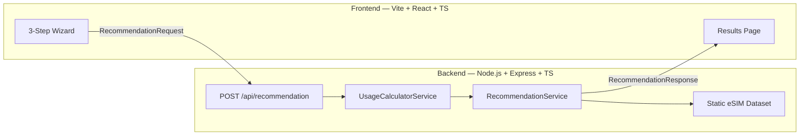
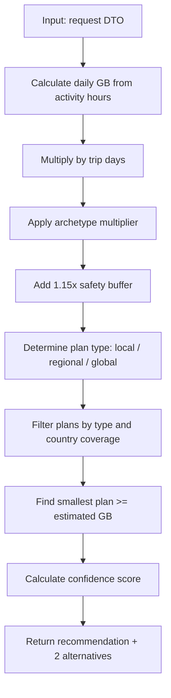
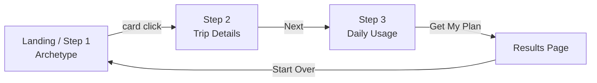

# eSIM Travel Connectivity Planner — Implementation Plan

## Architecture Overview



## Folder Structure

```
/
├── frontend/
│   ├── src/
│   │   ├── components/
│   │   │   ├── ui/                   # shadcn/ui primitives
│   │   │   ├── wizard/
│   │   │   │   ├── ArchetypeStep.tsx
│   │   │   │   ├── TripStep.tsx
│   │   │   │   └── UsageStep.tsx
│   │   │   ├── results/
│   │   │   │   ├── RecommendationCard.tsx
│   │   │   │   ├── AlternativePlans.tsx
│   │   │   │   ├── ConfidenceBar.tsx
│   │   │   │   └── UsageBreakdown.tsx
│   │   │   └── layout/
│   │   │       ├── Header.tsx
│   │   │       └── StepIndicator.tsx
│   │   ├── pages/
│   │   │   ├── WizardPage.tsx        # hosts all 3 steps
│   │   │   └── ResultsPage.tsx
│   │   ├── hooks/
│   │   │   └── useRecommendation.ts  # async fetch + loading state
│   │   ├── lib/
│   │   │   └── api.ts                # typed fetch wrapper
│   │   ├── types/
│   │   │   └── index.ts              # shared TS types
│   │   ├── App.tsx
│   │   └── main.tsx
│   ├── package.json
│   ├── vite.config.ts
│   └── tailwind.config.ts
│
├── backend/
│   ├── src/
│   │   ├── data/
│   │   │   ├── countries.ts          # country → region mapping
│   │   │   └── esim-plans.ts         # full plan dataset
│   │   ├── dto/
│   │   │   └── recommendation.dto.ts # Zod schemas + inferred types
│   │   ├── services/
│   │   │   ├── usage-calculator.service.ts
│   │   │   └── recommendation.service.ts
│   │   ├── routes/
│   │   │   └── recommendation.route.ts
│   │   ├── middleware/
│   │   │   └── validate.ts           # Zod middleware
│   │   └── index.ts
│   ├── package.json
│   └── tsconfig.json
│
└── submission/
    ├── PROCESS.md
    └── how-to-launch.md
```

---

## Domain Logic

### 1. Data Usage Model (MB/hour — sourced from Saily blog)

| Activity | MB/hour | Rationale |
|---|---|---|
| Social Media | 150 MB | Feed scrolling + short video mix (Facebook ~120, TikTok ~840 — blended moderate usage) |
| Streaming | 700 MB | Between SD (~1 GB) and compressed mobile quality |
| Work | 300 MB | Video calls ~600 MB/hr, email/cloud ~100 MB/hr — blended |
| Navigation | 20 MB | Google Maps turn-by-turn ~10–20 MB/hr |

**Implementation** in `usage-calculator.service.ts`:

```typescript
const MB_PER_HOUR = {
  social: 150,
  streaming: 700,
  work: 300,
  navigation: 20,
} as const;

function calcDailyGb(hours: ActivityHours): number {
  const totalMb =
    hours.social * MB_PER_HOUR.social +
    hours.streaming * MB_PER_HOUR.streaming +
    hours.work * MB_PER_HOUR.work +
    hours.navigation * MB_PER_HOUR.navigation;
  return totalMb / 1024;
}
```

### 2. Traveler Archetype Multipliers

Your proposed multipliers are solid. One suggested adjustment:

- Casual: **0.8x** — confirmed (hotel WiFi reduces mobile data dependency)
- Explorer: **1.0x** — confirmed (good baseline)
- Adventure: **1.3x** instead of 1.25x — rationale: offline map pre-downloads, reconnection spikes in remote areas, and unpredictable backup data consumption justify a slightly higher buffer

### 3. Device Count — Per-Device Model

Since each traveler needs their own physical eSIM, the recommendation is per device. The device count affects:
- **Number of plans to buy** (e.g. "You need 2 plans")
- **Total price displayed** (`plan.price × travelerCount`)
- **No multiplier on estimated GB per person** — each person uses the same amount individually

Proposed traveler count options and display labels:
- Solo (1 device) — `1.0x`
- Pair (2 devices) — recommend 2 identical plans
- Group 3+ (3 devices) — recommend 3+ plans

> If you later want to support hotspot sharing (1 device for all), a multiplier model of `1.0 / 1.8 / 2.4` makes sense. I recommend keeping it per-device for now as it maps correctly to how eSIMs actually work.

### 4. Plan Type Determination (from selected countries)

Located in `recommendation.service.ts`:

```typescript
function determinePlanType(countryCodes: string[]): PlanType {
  if (countryCodes.length === 1) return "local";
  const regions = new Set(countryCodes.map(code => COUNTRIES[code].region));
  return regions.size === 1 ? "regional" : "global";
}
```

### 5. Country → Region Mapping

```typescript
// countries.ts
export const COUNTRIES: Record<string, Country> = {
  GB: { name: "United Kingdom", region: "Europe" },
  PL: { name: "Poland",         region: "Europe" },
  TR: { name: "Turkey",         region: "Europe" }, // included in EU eSIM coverage
  ME: { name: "Montenegro",     region: "Europe" },
  AL: { name: "Albania",        region: "Europe" },
  CH: { name: "Switzerland",    region: "Europe" },
  JP: { name: "Japan",          region: "Asia"   },
  CN: { name: "China",          region: "Asia"   },
  KR: { name: "South Korea",    region: "Asia"   },
  US: { name: "United States",  region: "North America" },
};
```

> Turkey is placed in Europe — this matches most major eSIM providers' regional bundling. Note it in the UI with a tooltip if needed.

### 6. Recommendation Algorithm (full flow)



**Confidence score formula**:
```typescript
// ratio = how much of the plan you actually use
const usageRatio = estimatedGb / plan.gb;
if (usageRatio >= 0.7)  confidence = 92; // near-perfect fit
else if (usageRatio >= 0.5) confidence = 76;
else if (usageRatio >= 0.3) confidence = 60;
else confidence = 45; // large safety margin chosen
```

### 7. eSIM Plan Dataset Structure

Each plan in `esim-plans.ts`:

```typescript
interface ESimPlan {
  id: string;
  name: string;
  type: "local" | "regional" | "global";
  region: "Europe" | "Asia" | "North America" | "Global";
  countries: string[]; // ISO codes, or ["ALL"] for global
  gb: number;
  validity: number; // days
  price: number;    // USD
}
```

**Dataset tiers**:
- Local plans: 5 GB and 10 GB per supported country (17 plans)
- Regional plans: Europe 3/10/20 GB, Asia 5/10/20 GB (6 plans)
- Global plans: 5/10/20/50 GB (4 plans)

Sample prices (realistic but fictional):

| Type | GB | Price |
|---|---|---|
| Local EU | 5 | $6.99–9.99 |
| Local US | 10 | $16.99 |
| Europe Regional | 10 | $22.99 |
| Asia Regional | 10 | $24.99 |
| Global Standard | 10 | $39.99 |
| Global Plus | 20 | $59.99 |

---

## API Design

### `POST /api/recommendation`

**Request DTO** (validated with Zod):

```typescript
const RecommendationRequestSchema = z.object({
  countries:      z.array(z.string().length(2)).min(1).max(10),
  startDate:      z.string().datetime(),
  endDate:        z.string().datetime(),
  travelerType:   z.enum(["casual", "explorer", "adventure"]),
  travelerCount:  z.union([z.literal(1), z.literal(2), z.literal(3)]),
  socialHours:    z.number().min(0).max(12),
  streamingHours: z.number().min(0).max(12),
  workHours:      z.number().min(0).max(12),
  navigationHours:z.number().min(0).max(12),
});
```

**Response DTO**:

```typescript
interface RecommendationResponse {
  tripDays: number;
  estimatedGbPerPerson: number;
  totalEstimatedGb: number;
  planType: "local" | "regional" | "global";
  recommendedPlan: ESimPlan;
  alternativePlans: ESimPlan[];     // 2 alternatives (one tier up, one tier down)
  reasons: string[];                // human-readable explanation strings
  confidence: number;               // 0–100
  travelerCount: number;
  totalPrice: number;               // plan.price × travelerCount
}
```

**Example reasons array**:
```
["Visiting 2 countries in the same region — regional plan recommended",
 "Adventure traveler multiplier applied (+30% buffer)",
 "Streaming adds ~4.9 GB over your 7-day trip",
 "Closest matching plan covers your 8.3 GB estimate"]
```

**Route structure** (`recommendation.route.ts`):
```
POST /api/recommendation  →  validate → usageCalc → recommendation → respond
GET  /api/countries       →  return COUNTRIES dataset (for frontend dropdown)
GET  /api/health          →  { status: "ok" }
```

---

## Frontend UI Flow

### Step Flow



### Step 1 — Archetype Selection

- 3 large clickable cards, full-width or 3-column grid
- Each card: icon, name, 2-line description, multiplier badge
- Selected card gets a highlighted ring + checkmark
- No "Next" button needed — clicking a card auto-advances

### Step 2 — Trip Details

- Country multi-select (searchable combobox using shadcn `Command` + `Popover`)
- Date range picker (shadcn `Calendar` or `DateRangePicker`)
- Traveler count: 3 pill buttons (Solo / Pair / Group 3+)
- Inline derived info: "Trip: 7 days" auto-calculated from dates
- Region tag(s) shown below country selection (e.g. "Europe · Asia")

### Step 3 — Daily Usage

- 4 activity cards each with a slider (0–8 hours) or +/− stepper
- Each card shows: icon, activity name, current hours, and live MB/day estimate
- Bottom summary: "Estimated ~X GB total for your trip" (live-updated)
- CTA: "Find My eSIM Plan" button

### Results Page

- Hero `RecommendationCard`: plan name, GB, validity, price per person, total price
- `ConfidenceBar`: visual bar with label (e.g. "92% — Great match")
- `UsageBreakdown`: donut/bar showing social/streaming/work/nav contributions
- `ReasonTags`: chip list explaining why this plan was chosen
- `AlternativePlans`: 2 smaller cards (e.g. one step smaller, one step larger)
- "Start Over" ghost button

### State Management

A single React `useReducer` + Context in `WizardPage` holds all form state. No external state library needed for this scope. `react-hook-form` handles per-step validation; Zod schemas are shared between frontend and backend.

### Loading State

`useRecommendation` hook manages:
```
idle → loading (spinner overlay on "Find My Plan" click)
     → success (navigate to ResultsPage with data)
     → error (inline error banner with retry)
```

---

## Backend Tech Choices

| Concern | Choice | Reason |
|---|---|---|
| Framework | Express.js | Minimal, well-known, quick setup |
| Language | TypeScript | Shared types with frontend |
| Validation | Zod | Runtime + type safety, shareable schemas |
| Dev server | ts-node-dev | Hot reload without extra config |
| No DB | Static TS objects | Intentionally lightweight as specified |

---

## Deployment Strategy

- **Frontend**: Vite build → deploy to [Vercel](https://vercel.com) (free, zero config, `VITE_API_URL` env var points to backend)
- **Backend**: Deploy to [Render](https://render.com) free tier or [Railway](https://railway.app) — `npm run build && node dist/index.js`
- **Local dev**: Two terminals — `npm run dev` in each folder, frontend proxies `/api` to `localhost:3001`

---

## Recommendation on Multipliers

| Parameter | Proposed | Suggested | Notes |
|---|---|---|---|
| Casual archetype | 0.8x | **0.8x** — keep | Hotel WiFi reduces reliance |
| Explorer archetype | 1.0x | **1.0x** — keep | Clean baseline |
| Adventure archetype | 1.25x | **1.3x** — slight raise | Remote areas, reconnection spikes, offline map downloads |
| Safety buffer | — | **+15%** added | Applied after archetype multiplier, before plan match |
